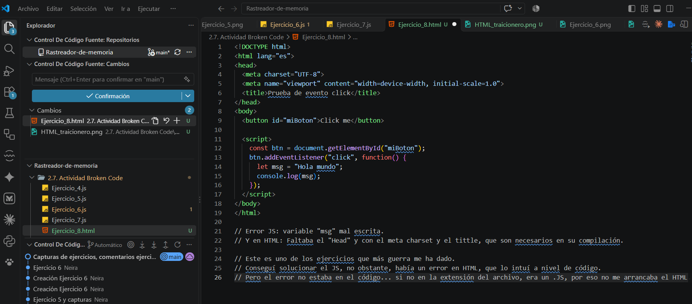

# 1 : La variable inexistente.

La variable "result" que guarda los valores de la variable "a y b" estaba mal escrita
fue declarada como result y para mostrarla fue llamada "+ reslt".

----------------------------------------------------------------------------------
# 2: Comparaciones sospechosas.

El error de este ejercicio era un error sintáctico en el if siendo la corrección: >= (mayor o igual).
=> Es una función flecha (que es una forma corta de escribir una función).

-----------------------------------------------------------------------------------
# 3: Return of the Jedi.

Para que una función muestre el resultado debe devolverlo, y el return estaba comentado. Por tanto, no devuelve nada.

-----------------------------------------------------------------------------------
# 4: Names...Names.

En la función saludar(nombre), la variable está definida como "name" , no como nombre.
Por tanto, no devolverá el saludo.

------------------------------------------------------------------------------------
# 5: Out of control

El bucle estaba recorriendo 5 veces por el array: "<=". Una vez quitado el "=" ya funciona correctamente y hace la suma sin errores.

-------------------------------------------------------------------------------------
# 6: Usando expresiones.

Es igualdad estricta (booleano) y  faltaban los "==" en el código.
Por tanto, si el resto de la división entre 2 === 0: TRUE. Si no es FALSO.

-------------------------------------------------------------------------------------
# 7: Callback defectuoso.

 En este programa las variables de "datos" no estaban correctamente escritas, dando error en el código

 -------------------------------------------------------------------------------------
 # 8: Evento click sospechoso.

 Error JS: variable "msj" mal escrita. 
Error HTML: Faltaba  `<title>Botón click</title>`que es necesario para que le navegador lo interprete.

Este es el ejercicio que más guerra me ha dado.
Conseguí solucionar el JS, no obstante, había un error en HTML, que lo intuí a nivel de código.
Pero el error no estaba en el código... si no en la extensión del archivo, era un .JS, por eso no me arrancaba el HTML.

---------------------------------------------------------------------------------------
# 9: Cálculo misterioso.
El fallo se encontraba en la segunda llamada, que pasaba 60 en vez de 0.6
100 - 100 * 60. Al ir antes la multiplicación sale el resultado en negativo -5900.

